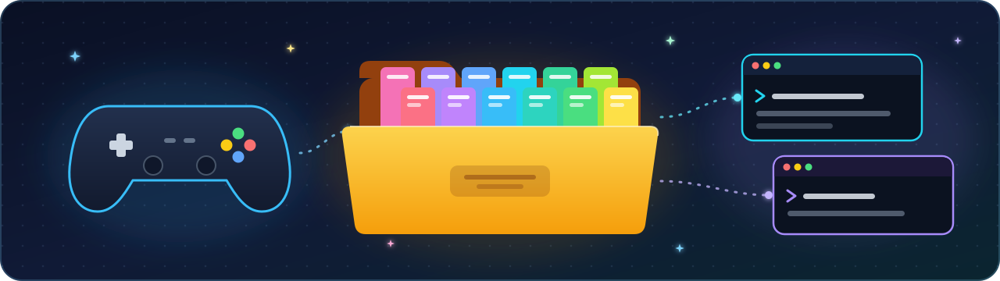
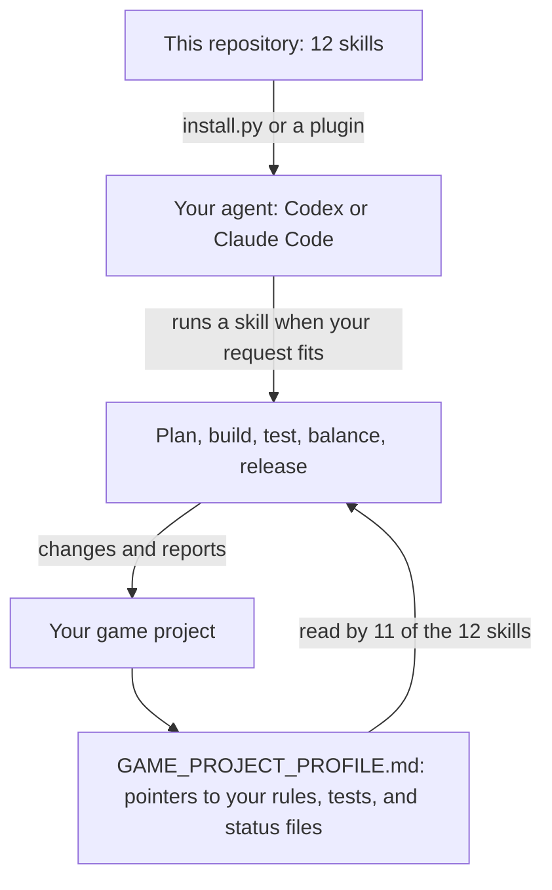

<p align="center">
  
</p>

<h1 align="center">Skills Folder</h1>

<p align="center">Twelve ready-made skills that teach an AI coding agent how to plan, build, test, and release a game with you.</p>

<p align="center">
  <a href="https://github.com/mewzicians/Skills-Folder/actions/workflows/verify.yml"></a>
</p>

<p align="center"><strong>Version 1.1.0. The installer is tested on Windows in temporary folders. The plugin routes, and runs on macOS and Linux, are documented but not yet verified.</strong></p>

<p align="center">
  <a href="#install"></a>
  <a href="#the-12-skills"></a>
  <a href="#fit-it-to-your-game"></a>
  <a href="docs/COMPATIBILITY.md"></a>
</p>

<p align="center">
  <a href="#install">Install</a> ·
  <a href="#the-12-skills">Skills</a> ·
  <a href="#fit-it-to-your-game">Customize</a> ·
  <a href="docs/COMPATIBILITY.md">Compatibility</a>
</p>

A skill is a folder with a `SKILL.md` file that tells an agent, such as
Codex or Claude Code, how to do one kind of job well. These skills cover game
work: design, balance, playtests, building, debugging, usability, music,
cleanup, verification, and release. None of them is tied to one engine,
genre, or game.

## How it fits together

<div align="center">



</div>

You install the skills once. Each game you work on can add an optional
profile that points the skills at that game's own files, so the skills
themselves stay generic.

## Start here

| You want to... | Open |
| --- | --- |
| Install the skills for Claude Code or Codex | [Install](#install) |
| See what each skill does | [The 12 skills](#the-12-skills) |
| Check which agent hosts work and what was tested | [Supported hosts](#supported-hosts) and [docs/COMPATIBILITY.md](docs/COMPATIBILITY.md) |
| Upgrade from version 1.0 | [Upgrading from 1.0.x](#upgrading-from-10x) |
| Point the skills at your own game | [Fit it to your game](#fit-it-to-your-game) |
| Update, uninstall, or find a backup | [Update, uninstall, and backups](#update-uninstall-and-backups) |
| See what the automated checks cover | [Validation](#validation) |

## The 12 skills

Skills marked **explicit only** have side effects, so they run only when you
name them: type `$game-release` in Codex, or `/game-release` in Claude Code.
The others can also start on their own when your request matches their
description.

| Skill | What it helps with |
| --- | --- |
| [`game-plan`](skills/game-plan/SKILL.md) | Talk through design, systems, economy, and pacing decisions from your project's records, without writing code. |
| [`game-balance-lab`](skills/game-balance-lab/SKILL.md) | Test whether something is too strong or too weak with simulations, telemetry, and controlled comparisons. Codex shows it as Balance Sim Lab. |
| [`game-playtest-analysis`](skills/game-playtest-analysis/SKILL.md) | Turn playtest notes, recordings, saves, and surveys into ranked findings and next experiments. |
| [`game-implement`](skills/game-implement/SKILL.md) | Build an approved change end to end: logic, UI, saves, tests, and documentation. |
| [`game-debug`](skills/game-debug/SKILL.md) | Reproduce a bug, find the cause, fix it narrowly, and add a regression test. |
| [`game-ux-audit`](skills/game-ux-audit/SKILL.md) | Check onboarding, navigation, readability, feedback, and accessibility. |
| [`music-composer`](skills/music-composer/SKILL.md) | Compose, critique, arrange, and produce music by listening and iterating. |
| [`game-qa-cleanup`](skills/game-qa-cleanup/SKILL.md) | **Explicit only.** Reconcile documentation, handoffs, mirrors, and manifests without changing gameplay or removing files on its own. |
| [`game-full-verification`](skills/game-full-verification/SKILL.md) | **Explicit only.** Gather complete ship-readiness evidence across requirements, rules, UI, saves, performance, and packaging. |
| [`game-release`](skills/game-release/SKILL.md) | **Explicit only.** Synchronize and byte-check release copies, such as a public mirror, run pre-publish checks, then stop until you say to publish. |
| [`game-context-continuity`](skills/game-context-continuity/SKILL.md) | Save and recover the state of long work across context compaction, interruptions, and handoffs. |
| [`game-skill-auditor`](skills/game-skill-auditor/SKILL.md) | Audit, test, and repair agent skills, including these. |

Every skill follows the same habits: read the game and its records before
acting, keep your approvals and status labels intact, prefer evidence a
player could reproduce, treat passing tests as evidence rather than proof of
a good player experience, report checks that did not run, and make the
smallest change that lasts.

## Supported hosts

| Host | How to install | Explicit-only skills |
| --- | --- | --- |
| Codex (CLI, IDE extension, and app) | `install.py` | Enforced: each one sets `policy.allow_implicit_invocation: false` in its `agents/openai.yaml`, which Codex honors. |
| Claude Code | The plugin marketplace, or `install.py --target claude` | Not enforced: Claude Code relies on each description saying "Use when the user explicitly asks...". Claude Code's own switch is a key that Codex's skill validator rejects, and both hosts share one `SKILL.md`, so this suite does not set it. |
| ChatGPT | Only through a workspace admin importing this repository's plugin marketplace, or through Codex in the ChatGPT desktop app, which reads skills from a local project's primary folder. ChatGPT has no documented way for an individual to upload a `SKILL.md`. | Not verified. |

Other tools that read `SKILL.md` folders can use `install.py --dest`.
[docs/COMPATIBILITY.md](docs/COMPATIBILITY.md) lists what was verified on a
real machine and what is only documented.

## Before you start

| Route | You need |
| --- | --- |
| Claude Code plugin | Claude Code. No Python. |
| `install.py` (Codex or Claude Code) | Python 3.11 or later, and the files from [Get the files](#get-the-files). |
| Copy by hand | Nothing extra: copy each folder in `skills/` into your host's skills folder. You lose the upgrade checks and backups. |

`install.py` is a plain Python script, so it needs no PowerShell execution
policy change and no build step. Use the command for your system:

| System | Run it as | Watch out for |
| --- | --- | --- |
| Windows | `py -3 install.py ...` (the Python launcher), or `python install.py ...` | If `python` or `python3` opens the Microsoft Store or prints nothing, you are hitting an App Execution Alias, not Python. Install Python 3.11 or later from python.org, or turn the aliases off in Settings > Apps > Advanced app settings > App execution aliases. |
| macOS | `python3 install.py ...` | The `python3` that comes with Apple's Command Line Tools is often 3.9, which is too old. Install 3.11 or later from python.org or Homebrew. |
| Linux | `python3 install.py ...` | Debian 12 ships 3.11 and Ubuntu 24.04 ships 3.12. RHEL 9 and its rebuilds default to 3.9: install the `python3.11` package and run `python3.11 install.py ...`. |

Check your version with `py -3 --version` or `python3 --version`. The
examples below say `python`; use your system's command instead.

## Get the files

Cloning is best, because updating is then one command:

```text
git clone https://github.com/mewzicians/Skills-Folder.git
cd Skills-Folder
```

No git? On the repository page choose **Code**, then **Download ZIP**,
extract it, and open a terminal in the extracted folder. Everything below
works the same way; to update later, download a fresh ZIP.

## Install

### Claude Code

**Plugin marketplace (documented, not verified on a real install).** Inside
Claude Code, run:

```text
/plugin marketplace add mewzicians/Skills-Folder
/plugin install game-dev-skills@skills-folder
```

Plugin skills carry the plugin's name, so you invoke them as, for example,
`/game-dev-skills:game-release`.

**install.py (tested in temporary folders).** From the repository folder:

```text
python install.py install --target claude
```

This copies the skills to `~/.claude/skills`, or to
`$CLAUDE_CONFIG_DIR/skills` when you set `CLAUDE_CONFIG_DIR`. Use one route,
not both, so each skill appears once.

### Codex

```text
python install.py install
```

This copies the skills to `~/.agents/skills` (on Windows,
`%USERPROFILE%\.agents\skills`), where Codex looks for your personal skills.
The repository also carries Codex plugin files; that route is documented but
not verified (see [docs/COMPATIBILITY.md](docs/COMPATIBILITY.md)).

### What the installer does

`install.py` prints a plan and asks before it changes anything (add `--yes`
to skip the question). For each skill it installs a missing one, skips an
identical one, and upgrades an older one after backing it up. It refuses,
and changes nothing, when:

| It reports | Meaning | To go ahead anyway |
| --- | --- | --- |
| newer | The installed copy has a newer recorded version. | `--allow-downgrade` |
| unrecorded or modified | The copy differs, and this installer did not put those bytes there: you edited it, or another tool or version 1.0 installed it. | `--replace-modified` (the old copy is backed up first) |
| would share its name | The same skill is in another folder that the same host loads, such as `~/.codex/skills`. Both paths are printed. | Remove one copy, or `--allow-duplicate-names` |
| link | The installed copy is a symbolic link or junction. | Replace the link by hand. |

It also offers to move three skills that version 1.0 installed and 1.1
retired (`game-github-package`, `game-skill-creator`, and
`game-skill-installer`) to backups, and asks separately before it does.
Changes are staged next to the skills folder and swapped in together; if
anything fails, every change is rolled back. It never uses the network.

Other places to install:

| Target | Skills folder | Loaded by |
| --- | --- | --- |
| `--target codex` (the default) | `~/.agents/skills` | Codex, in every project |
| `--target codex-legacy` | `$CODEX_HOME/skills`, or `~/.codex/skills` when `CODEX_HOME` is unset | Codex's older personal folder, where version 1.0 installed |
| `--target codex-project --project DIR` | `DIR/.agents/skills` | Codex, in that project; also Codex in the ChatGPT desktop app when `DIR` is the project's primary folder |
| `--target claude` | `~/.claude/skills`, or `$CLAUDE_CONFIG_DIR/skills` | Claude Code, in every project |
| `--target claude-project --project DIR` | `DIR/.claude/skills` | Claude Code, in that project |
| `--dest DIR` | `DIR` | Any other tool that reads `SKILL.md` folders |

`CODEX_HOME` is read the way Codex reads it: an empty value counts as unset,
`~` is not expanded, and the folder must already exist.

### Check that it worked

Start a new agent session and type `/skills`, in Codex or Claude Code, to
see the list. On the command line, `python install.py status` shows what is
installed in each folder, which copies are current, and any duplicates.

## Update, uninstall, and backups

- **Update:** run `git pull` (or download a fresh ZIP), then run the same
  `python install.py install` command again. Current skills are skipped and
  older ones are upgraded with a backup.
- **Uninstall:** `python install.py uninstall`, with the same `--target` you
  installed with. Skills move to a backup folder; nothing is deleted. It
  refuses copies you changed unless you add `--include-modified`.
- **Backups:** each run that replaces or removes a skill writes one dated
  folder with a `backup.json` list, outside every skills folder, so your
  agent never loads a backup:

  | System | Backup folder |
  | --- | --- |
  | Windows | `%LOCALAPPDATA%\skills-folder\backups` |
  | macOS | `~/Library/Application Support/skills-folder/backups` |
  | Linux | `$XDG_STATE_HOME/skills-folder/backups`, or `~/.local/state/skills-folder/backups` |

  To restore a skill, copy its folder from the backup into your skills
  folder. The install record, `install-ledger.json`, sits beside the
  `backups` folder.

## Upgrading from 1.0.x

Version 1.0 installed with `install-skills.ps1` into `$CODEX_HOME\skills` or
`~\.codex\skills` and kept no install record. Whenever it replaced a skill,
it left a `.game-skill-suite-backup-*` folder inside that skills folder.
Version 1.1 removed `game-skill-creator` and `game-skill-installer`, renamed
`game-github-package` to `game-release`, and replaced the PowerShell scripts
with Python: `install.py` and `tools/verify_package.py`.

1. See what you have: `python install.py status`.
2. Choose one:
   - **Keep the old folder:**
     `python install.py install --target codex-legacy --replace-modified`.
     The installer has no record of the 1.0 copies, so it needs
     `--replace-modified`. It backs up each old copy before replacing it and
     offers to move the retired skills to backups.
   - **Move to the new default folder:**
     `python install.py uninstall --target codex-legacy --include-modified`,
     then `python install.py install`.
3. Installing into the new default while the 1.0 copies are still in the
   old folder is refused, because Codex would load both.
4. The installer leaves the old `.game-skill-suite-backup-*` folders alone.
   Move them out of the skills folder yourself once you no longer need them.

## Fit it to your game

1. Copy [`templates/GAME_PROJECT_PROFILE.template.md`](templates/GAME_PROJECT_PROFILE.template.md)
   into your game repository as `GAME_PROJECT_PROFILE.md`.
2. Fill each field with a repository-relative path, a label, a command, or
   yes or no. The profile only points to the files that hold your rules and
   status. Your repository's instruction files, such as `AGENTS.md` and
   `CLAUDE.md`, win over it, and a blank field keeps the generic default.
3. Eleven of the twelve skills read the profile. `game-skill-auditor`
   audits skills rather than a game, so it does not.

[docs/SPECIALIZE.md](docs/SPECIALIZE.md) explains when a game-specific skill
is worth writing, how to write one with your host's own skill-creator, and
why changing project status never belongs inside a skill.

## Validation

On every push to `main`, every pull request, every Monday, and on demand,
the [GitHub Actions workflow](.github/workflows/verify.yml) runs these steps
on Windows, macOS, and Linux, with Python 3.11 and 3.15, plus 3.14 on Linux.
The badge at the top shows the latest result.

1. **Verify package:** `tools/verify_package.py --budgets` checks skill
   structure, portable frontmatter, UTF-8 and LF text, generated debris,
   private project names, generated-copy and identical-file drift, the
   explicit-only skills' policy and wording, the plugin manifests, the
   description and body budgets, and a neutrality lint
   for self-granted permissions, author-specific names, personal paths and
   addresses, private vault names, and committed continuity ledgers.
2. **Validate portable frontmatter:** `tools/validate_skill.py` on every
   skill.
3. **Run the strict static auditor on every skill.**
4. **Run tool tests:** the frontmatter, package-verifier, skill-script, and
   archive-builder tests.
5. **Run the installer tests in temporary homes:** every target, decision,
   refusal, rollback, backup, and uninstall, with a socket guard, failing if
   the runner's real skill folders change.
6. **Run the continuity self-test.**
7. **Run the auditor adversarial self-test.**
8. **Compare the frontmatter schema with PyYAML,** pinned by hash.

The workflow checks files and scripts. It does not start Codex or Claude
Code, install the plugin, or run any model.

<details>
<summary>Developer commands</summary>

Run these from the repository folder. Each needs only the Python standard
library.

```text
python -B tools/verify_package.py --budgets
python -B tools/verify_package.py --lint
python -B tools/validate_skill.py
python -B skills/game-skill-auditor/scripts/audit_skill.py skills/game-plan --json --strict
python -B tests/frontmatter/test_frontmatter.py
python -B tests/verify/test_verify_package.py
python -B tests/scripts/test_skill_scripts.py
python -B tests/zip/test_build_repository_zip.py
python -B tests/install/test_install.py
python -B skills/game-context-continuity/scripts/continuity_ledger.py self-test
python -B skills/game-skill-auditor/scripts/self_test.py
```

The PyYAML comparison, `tests/frontmatter/test_differential.py`, needs the
hash-pinned PyYAML from `requirements-ci.txt`; install it into a virtual
environment, never into your system Python.

Repository layout:

```text
skills/                   The 12 skill folders
templates/                The project profile template
tools/                    Package verifier and frontmatter validator
tests/                    Tests for the tools, the skill scripts, and install.py
docs/                     Frontmatter schema, specialization guide, compatibility notes
.claude-plugin/           Claude Code plugin manifest and marketplace
.agents/plugins/          Codex plugin marketplace
plugin.json               Portable Agent Plugins manifest
install.py                Installer for Codex and Claude Code
VERSION                   The suite version
```

</details>

## License

Licensed under Apache-2.0. See [LICENSE](LICENSE) and [NOTICE](NOTICE).
