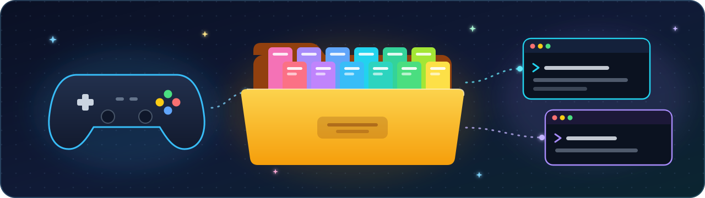
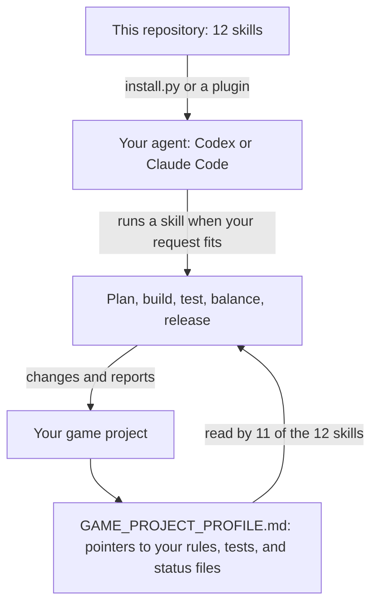

<p align="center">
  
</p>

<h1 align="center">Skills Folder</h1>

<p align="center">Twelve ready-made skills that teach an AI coding agent how to plan, build, test, and release a game with you.</p>

<p align="center">
  <a href="https://github.com/mewzicians/Skills-Folder/actions/workflows/verify.yml"></a>
</p>

<p align="center"><strong>Version 1.3.0. Every check, including the installer tests in temporary folders, runs in CI on Windows, macOS, and Linux. The plugin routes and the hosts loading the installed skills are documented but not yet verified.</strong></p>

<p align="center">
  <a href="#install"></a>
  <a href="#the-12-skills"></a>
  <a href="#fit-it-to-your-game"></a>
  <a href="docs/COMPATIBILITY.md"></a>
  <a href="CHANGELOG.md"></a>
</p>

<p align="center">
  <a href="#install">Install</a> ·
  <a href="#the-12-skills">Skills</a> ·
  <a href="#fit-it-to-your-game">Customize</a> ·
  <a href="docs/COMPATIBILITY.md">Compatibility</a> ·
  <a href="CHANGELOG.md">Changelog</a>
</p>

A skill is a folder with a `SKILL.md` file that tells an agent, such as
Codex or Claude Code, how to do one kind of job well. These skills cover game
work: design, balance, playtests, building, debugging, usability, music,
cleanup, verification, and release. None of them is tied to one engine,
genre, or game.

## How it fits together

<div align="center">



</div>

You install the skills once. Each game you work on can add an optional
profile that points the skills at that game's own files, so the skills
themselves stay generic.

## Start here

| You want to... | Open |
| --- | --- |
| Install the skills for Claude Code or Codex | [Install](#install) |
| See what each skill does | [The 12 skills](#the-12-skills) |
| Check which agent hosts work and what was tested | [Supported hosts](#supported-hosts) and [docs/COMPATIBILITY.md](docs/COMPATIBILITY.md) |
| Upgrade from version 1.1 | [Upgrading from 1.1.x](docs/INSTALL.md#upgrading-from-11x) |
| Upgrade from version 1.0 | [Upgrading from 1.0.x](docs/INSTALL.md#upgrading-from-10x) |
| See what changed in each version | [CHANGELOG.md](CHANGELOG.md) |
| Point the skills at your own game | [Fit it to your game](#fit-it-to-your-game) |
| Update, uninstall, or find a backup | [Update, uninstall, and backups](docs/INSTALL.md#update-uninstall-and-backups) |
| Finish a run that says "Recovery is incomplete" | [If a run says "Recovery is incomplete"](docs/INSTALL.md#if-a-run-says-recovery-is-incomplete) |
| See what the automated checks cover | [Validation](#validation) |

## The 12 skills

Skills marked **explicit only** have side effects, so they are meant to run
only when you name them: type `$game-release` in Codex, or `/game-release` in
Claude Code. Codex enforces this (documented, not verified); Claude Code
relies on the description's wording (see [Supported hosts](#supported-hosts)).
The other skills can also start on their own when your request matches their
description.

| Skill | What it helps with |
| --- | --- |
| [`game-plan`](skills/game-plan/SKILL.md) | Talk through design, systems, economy, and pacing decisions from your project's records, without writing code. |
| [`game-balance-lab`](skills/game-balance-lab/SKILL.md) | Test whether something is too strong or too weak with simulations, telemetry, and controlled comparisons. Codex shows it as Balance Sim Lab. |
| [`game-playtest-analysis`](skills/game-playtest-analysis/SKILL.md) | Turn playtest notes, recordings, saves, and surveys into ranked findings and next experiments. |
| [`game-implement`](skills/game-implement/SKILL.md) | Build an approved change end to end: logic, UI, saves, tests, and documentation. |
| [`game-debug`](skills/game-debug/SKILL.md) | Reproduce a bug, find the cause, fix it narrowly, and add a regression test. |
| [`game-ux-audit`](skills/game-ux-audit/SKILL.md) | Check onboarding, navigation, readability, feedback, and accessibility. |
| [`music-composer`](skills/music-composer/SKILL.md) | Compose, critique, arrange, and produce music by listening and iterating. |
| [`game-qa-cleanup`](skills/game-qa-cleanup/SKILL.md) | **Explicit only.** Reconcile documentation, handoffs, mirrors, and manifests without changing gameplay or removing files on its own. |
| [`game-full-verification`](skills/game-full-verification/SKILL.md) | **Explicit only.** Gather complete ship-readiness evidence across requirements, rules, UI, saves, performance, and packaging. |
| [`game-release`](skills/game-release/SKILL.md) | **Explicit only.** Synchronize and byte-check release copies, such as a public mirror, run pre-publish checks, then stop until you say to publish. |
| [`context-continuity`](skills/context-continuity/SKILL.md) | Save and recover the state of long work across context compaction, interruptions, and handoffs. Works on any project, not only games. |
| [`skill-auditor`](skills/skill-auditor/SKILL.md) | Audit, test, and repair agent skills, including these. Works on any skill, not only game skills. |

Every skill follows the same habits: read the game and its records before
acting, keep your approvals and status labels intact, prefer evidence a
player could reproduce, treat passing tests as evidence rather than proof of
a good player experience, report checks that did not run, and make the
smallest change that lasts.

## Supported hosts

| Host | How to install | Explicit-only skills |
| --- | --- | --- |
| Codex (CLI, IDE extension, and app) | `install.py`, or the plugin marketplace (documented, not verified) | Documented, not verified: each one sets `policy.allow_implicit_invocation: false` in its `agents/openai.yaml`; Codex documents that it then starts the skill only when you name it. |
| Claude Code | The plugin marketplace, or `install.py --target claude` | Not enforced: Claude Code relies on each description saying "Use when the user explicitly asks...". Claude Code's own switch is a key that Codex's skill validator rejects, and both hosts share one `SKILL.md`, so this suite does not set it. |
| ChatGPT | Documented, not verified: the ChatGPT desktop app uses standalone skills, as Codex CLI and the IDE extension do, so `install.py` serves it too; its plugin directory reads this repository's marketplaces when you open the repository, or a personal `~/.agents/plugins/marketplace.json`; `codex plugin marketplace add mewzicians/Skills-Folder` adds the marketplace; and for an organization, a workspace admin can import the repository. | Not verified. |

Other tools that read `SKILL.md` folders can use `install.py --dest`.
[docs/COMPATIBILITY.md](docs/COMPATIBILITY.md) lists what was verified on a
real machine and what is only documented.

## Install

You need Python 3.11 or later for `install.py`, or only the host for a plugin
install. From a clone of this repository:

| Host | Command |
| --- | --- |
| Codex | `python install.py install` (copies to `~/.agents/skills`) |
| Claude Code | `python install.py install --target claude` (copies to `~/.claude/skills`), or `/plugin marketplace add mewzicians/Skills-Folder` then `/plugin install game-dev-skills@skills-folder` |

The installer prints a plan and asks first, backs up anything it replaces,
and never uses the network. Run `python install.py status` to see what is
installed, and type `/skills` in a new session to check the host sees them.
[docs/INSTALL.md](docs/INSTALL.md) covers each system's Python command, every
target, updates, uninstalling, backups, recovery from an interrupted run, and
upgrading from 1.0.x or 1.1.x.

## Fit it to your game

1. Copy [`templates/GAME_PROJECT_PROFILE.template.md`](templates/GAME_PROJECT_PROFILE.template.md)
   into your game repository as `GAME_PROJECT_PROFILE.md`.
2. Fill each field with a repository-relative path, a label, a command, or
   yes or no. The profile only points to the files that hold your rules and
   status. Your repository's instruction files, such as `AGENTS.md` and
   `CLAUDE.md`, win over it, and a blank field keeps the generic default.
3. Eleven of the twelve skills read the profile. `skill-auditor`
   audits skills rather than a game, so it does not.

[docs/SPECIALIZE.md](docs/SPECIALIZE.md) explains when a game-specific skill
is worth writing, how to write one with your host's own skill-creator, and
why changing project status never belongs inside a skill.

## Validation

On every push to `main`, every pull request, every Monday, and on demand,
the [GitHub Actions workflow](.github/workflows/verify.yml) runs these steps
on Windows, macOS, and Linux, with Python 3.11 and 3.15. The Monday and
on-demand runs add Python 3.14 on Linux.
The badge at the top shows the latest result.

1. **Verify package:** `tools/verify_package.py --budgets` checks skill
   structure, portable frontmatter, UTF-8 and LF text, generated debris,
   private project names, generated-copy, identical-file, and shared-section
   drift, the explicit-only skills' policy and wording, the plugin
   manifests, one version across `VERSION`, both manifests, and the newest
   changelog entry, the relative links and images in the README, changelog,
   and `docs/`, the description and load budgets, and a neutrality lint for
   self-granted permissions, author-specific names, personal paths and
   addresses, private vault names, and committed continuity ledgers.
2. **Run the strict static auditor on every skill.**
3. **Run tool tests:** the frontmatter, package-verifier, skill-script, and
   archive-builder tests, including the `--metadata` and
   `tools/validate_skill.py` command lines.
4. **Run the installer tests in temporary homes:** every target, decision,
   refusal, rollback, interruption, concurrent run, damaged ledger or
   journal, backup, and uninstall, with a socket guard, failing if the
   runner's real skill folders change.
5. **Run the continuity self-test.**
6. **Run the auditor adversarial self-test.**
7. **Compare the frontmatter schema with PyYAML,** pinned by hash.

The workflow checks files and scripts. It does not start Codex or Claude
Code, install the plugin, or run any model; the
[real-host check](docs/COMPATIBILITY.md#real-host-check-per-release) covers
that, by hand, before each release.

<details>
<summary>Developer commands</summary>

Run these from the repository folder. Each needs only the Python standard
library.

```text
python -B tools/verify_package.py --budgets
python -B tools/verify_package.py --lint
python -B tools/verify_package.py --metadata
python -B tools/validate_skill.py
python -B skills/skill-auditor/scripts/audit_skill.py skills/game-plan --json --strict
python -B tests/frontmatter/test_frontmatter.py
python -B tests/verify/test_verify_package.py
python -B tests/scripts/test_skill_scripts.py
python -B tests/zip/test_build_repository_zip.py
python -B tests/install/test_install.py
python -B skills/context-continuity/scripts/continuity_ledger.py self-test
python -B skills/skill-auditor/scripts/self_test.py
```

The PyYAML comparison, `tests/frontmatter/test_differential.py`, needs the
hash-pinned PyYAML from `requirements-ci.txt`; install it into a virtual
environment, never into your system Python.

Repository layout:

```text
skills/                   The 12 skill folders
templates/                The project profile template
tools/                    Package verifier and frontmatter validator
tests/                    Tests for the tools, the skill scripts, and install.py
docs/                     Frontmatter schema, specialization guide, compatibility notes
.claude-plugin/           Claude Code plugin manifest and marketplace
.agents/plugins/          Codex plugin marketplace
plugin.json               Portable Agent Plugins manifest
install.py                Installer for Codex and Claude Code
VERSION                   The suite version
```

</details>

## License

Licensed under Apache-2.0. See [LICENSE](LICENSE) and [NOTICE](NOTICE).
